# Tugas Pemrograman Web — REST API CRUD dengan Prisma

| | |
| --- | --- |
| **Nama** | Syarifah Nailatur Rohma |
| **NRP** | 5027251109 |
| **Kelas** | A |
| **Mata Kuliah** | Pemrograman Web |

REST API untuk mengelola data **Mahasiswa**. Project ini melanjutkan tugas sebelumnya dengan menambahkan **Prisma ORM** untuk mengakses database. Seluruh operasi data (tambah, baca, ubah, hapus) kini dijalankan melalui Prisma, bukan lagi data statis.

Fitur yang tersedia:

- **GET** `/mahasiswa` — menampilkan seluruh data
- **POST** `/mahasiswa` — membuat data baru
- **PUT** `/mahasiswa/:id` — mengubah data yang sudah ada
- **DELETE** `/mahasiswa/:id` — menghapus data berdasarkan id

## Teknologi

- Node.js + Express.js
- Prisma ORM (versi 6)
- SQLite sebagai database
- CORS agar API dapat diakses dari client lain


## Cara Menjalankan

1. Install dependency:

   ```bash
   npm install
   ```

2. Buat file `.env` (salin dari contoh):

   ```bash
   cp .env.example .env
   ```

3. Jalankan migrasi untuk membuat tabel `Mahasiswa`:

   ```bash
   npx prisma migrate dev --name init
   ```

4. Jalankan server:

   ```bash
   npm run dev
   ```

   Server berjalan di `http://localhost:3000`. Untuk melihat isi database secara visual, jalankan `npx prisma studio`.

## Dokumentasi Endpoint

| Method | Endpoint          | Keterangan                | Body                     |
| ------ | ----------------- | ------------------------- | ------------------------ |
| GET    | `/mahasiswa`      | Menampilkan seluruh data  | -                        |
| POST   | `/mahasiswa`      | Membuat data baru         | `nama`, `nrp`, `jurusan` |
| PUT    | `/mahasiswa/:id`  | Mengubah data (by id)     | `nama`, `nrp`, `jurusan` |
| DELETE | `/mahasiswa/:id`  | Menghapus data (by id)    | -                        |

Contoh body untuk POST / PUT:

```json
{
  "nama": "Budi Santoso",
  "nrp": "5025221001",
  "jurusan": "Teknik Informatika"
}
```

---

# Laporan Evidence

Pengujian dilakukan menggunakan **curl** melalui PowerShell, dan perubahan database diamati melalui **Prisma Studio**. Setiap response menampilkan status code (`HTTP/1.1 ...`) beserta isi body-nya.

## A. Pengujian Endpoint

### 1. GET — Menampilkan seluruh data (200 OK)

Mengambil seluruh data mahasiswa yang tersimpan.

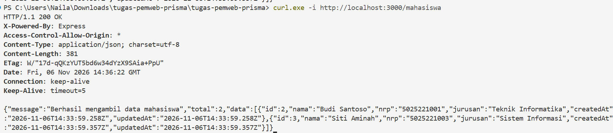

### 2. POST — Menambah data baru (201 Created)

Mengirim data valid, data berhasil tersimpan ke database.

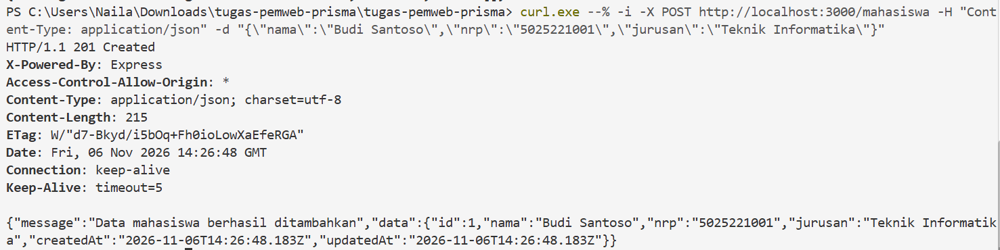

### 3. POST — Validasi gagal (400 Bad Request)

Salah satu field (`jurusan`) tidak dikirim, sehingga ditolak dengan pesan validasi.

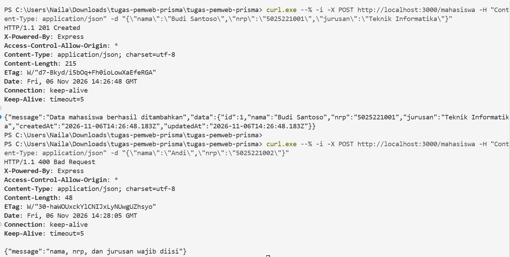

### 4. POST — NRP duplikat (400 Bad Request)

Mengirim `nrp` yang sudah terdaftar, ditolak karena `nrp` harus unik.

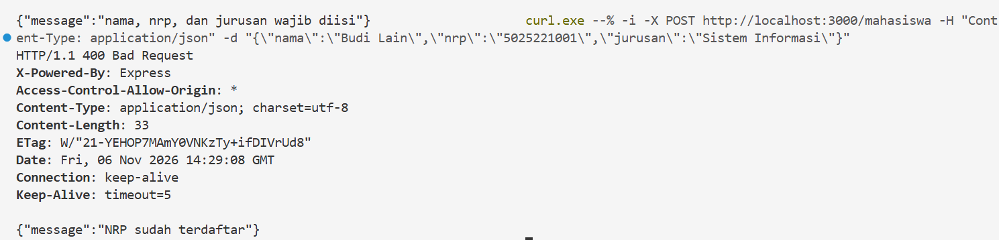

### 5. PUT — Mengubah data (200 OK)

Mengubah data mahasiswa dengan `id` yang valid.

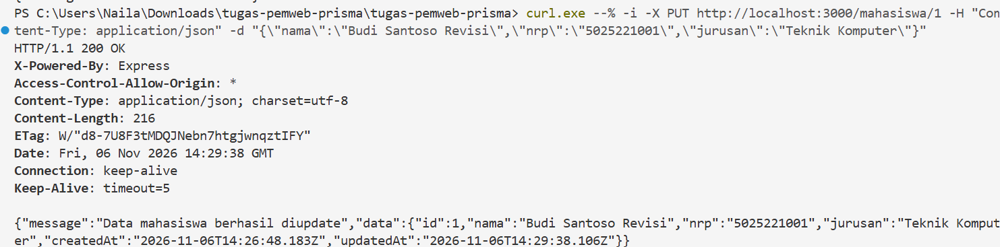

### 6. PUT — Data tidak ditemukan (404 Not Found)

Mengubah data dengan `id` yang tidak ada.

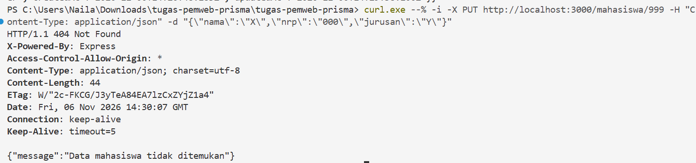

### 7. DELETE — Menghapus data (200 OK)

Menghapus data mahasiswa dengan `id` yang valid.

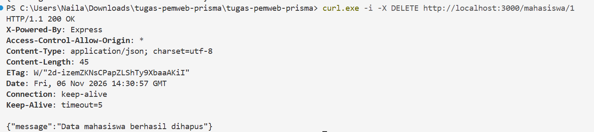

### 8. DELETE — Data tidak ditemukan (404 Not Found)

Menghapus data dengan `id` yang tidak ada.

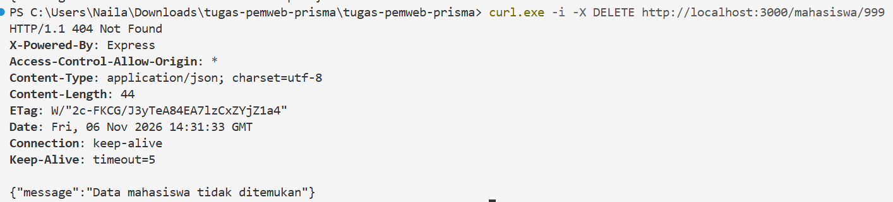

## B. Perubahan pada Database (before — after)

### POST — menambah data

Sebelum POST tabel masih kosong; setelah POST data mahasiswa bertambah.

| Before | After |
| ------ | ----- |
| 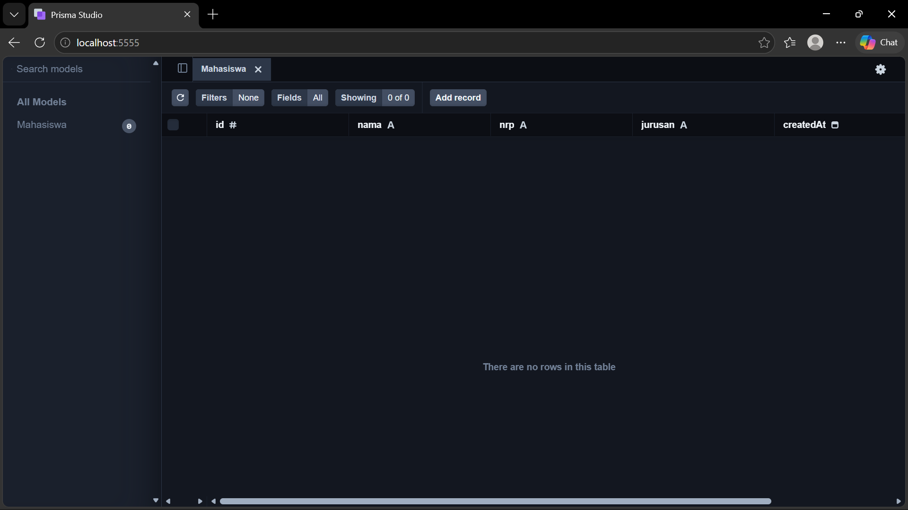 | 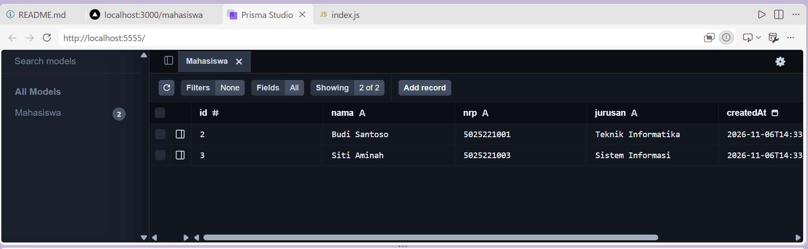 |

### DELETE — menghapus data

Sebelum DELETE terdapat dua data; setelah DELETE salah satu data terhapus.

| Before | After |
| ------ | ----- |
|  | 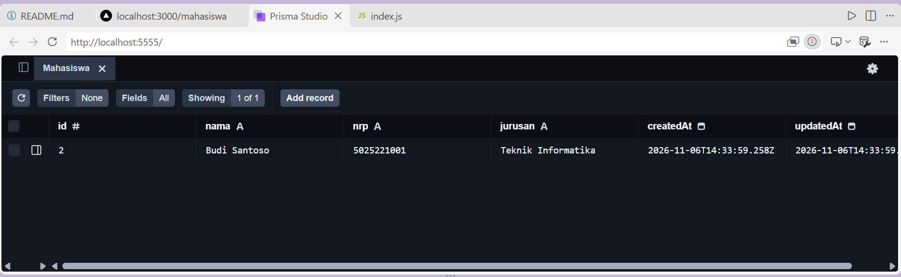 |

## Ringkasan Hasil Uji

| No | Skenario              | Status Diharapkan | Hasil |
| -- | --------------------- | ----------------- | ----- |
| 1  | GET seluruh data      | 200               | Sesuai |
| 2  | POST data valid       | 201               | Sesuai |
| 3  | POST field kosong     | 400               | Sesuai |
| 4  | POST NRP duplikat     | 400               | Sesuai |
| 5  | PUT data valid        | 200               | Sesuai |
| 6  | PUT id tidak ada      | 404               | Sesuai |
| 7  | DELETE data valid     | 200               | Sesuai |
| 8  | DELETE id tidak ada   | 404               | Sesuai |

Seluruh endpoint berjalan sesuai dengan yang diharapkan, dan perubahan data terkonfirmasi langsung pada database melalui Prisma Studio.
